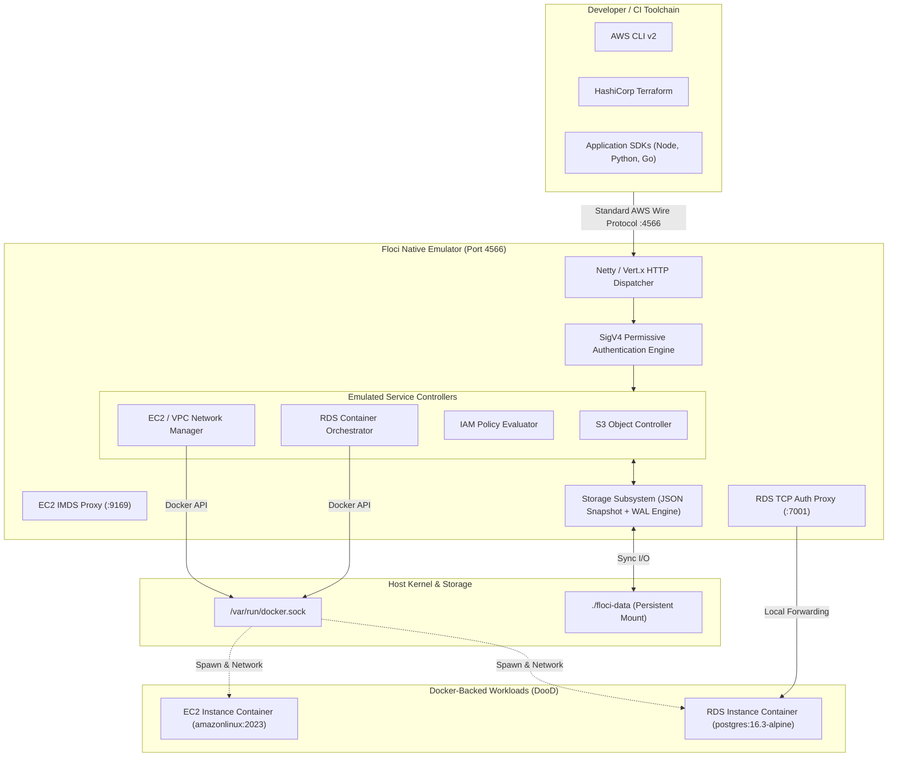
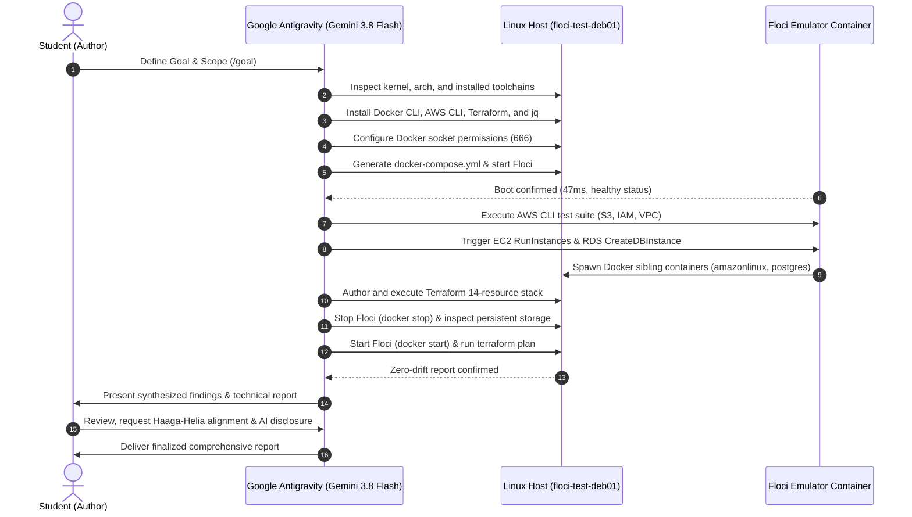

# Haaga-Helia University of Applied Sciences | Course Evaluation Report

**Degree Programme**: Business Information Technology (Software Development & Cloud Engineering)  
**Course**: Cloud Services (Pilvipalvelut)  
**Author**: Jude  
**Title**: Local AWS Cloud Infrastructure Emulation: Performance, API Compliance, and Lifecycle Evaluation Using Floci on Debian ARM64  
**Title in Finnish**: Paikallisen AWS-pilviympäristön emulointi: Suorituskyky, API-yhteensopivuus ja elinkaariarviointi Floci-alustalla Debian ARM64 -ympäristössä  
**Date**: 11 November 2026  
**Institution**: Haaga-Helia University of Applied Sciences, Helsinki, Finland  
**Target Audience**: Cloud Services Course Fellows & Course Faculty  

---

## Tiivistelmä

Nykyaikaisessa pilvinatiivissa ohjelmistokehityksessä infrastruktuuri koodina (Infrastructure as Code, IaC) ja automatisoitu laadunvarmistus edellyttävät toistettavia, kustannustehokkaita ja turvallisia testausympäristöjä. Perinteinen pilviresurssien käyttöönotto suoraan julkisessa pilvessä synnyttää merkittäviä kustannusriskejä, hidastaa kehityksen palautesykliä ja altistaa organisaatiot mahdollisille käyttöoikeus- ja tietoturvavuodoille. Tämän toiminnallisen selvityksen tavoitteena oli arvioida kattavasti avoimen lähdekoodin Floci-pilviemulaattorin (versio 2.4.0) toimintakykyä, API-yhteensopivuutta ja resurssien elinkaarenhallintaa eristetyssä Linux ARM64 -testiympäristössä (`floci-test-deb01`).

Arvioinnin laajuus rajattiin keskeisiin AWS-yhteensopiviin peruspalveluihin: S3-tallennuspalveluun, EC2-laskentakapasiteettiin, RDS-tietokantapalveluihin, IAM-käyttöoikeushallintaan sekä VPC-verkkoinfrastruktuuriin. Empiirinen toteutus suoritettiin käyttäen HashiCorp Terraform -työkalua virallisen `hashicorp/aws`-ajurin kautta ilman aitoja pilvitunnuksia sekä virallista AWS CLI -komentorivityökalua. Lisäksi tutkimuksessa selvitettiin Docker-ohjaimen liitännän (`/var/run/docker.sock`) kautta tapahtuvaa todellisten taustakonttien käynnistystä sekä emulaattorin tilan pysyvyyttä (`FLOCI_STORAGE_MODE=persistent`) kylmäkäynnistysten yli.

Tulokset osoittivat Floci-emulaattorin suoriutuvan kaikista asetetuista laatuvaatimuksista erinomaisesti. Emulaattorin käynnistysaika oli vain 47 millisekuntia ja muistijalanjälki idle-tilassa minimaalinen (~25–35 MiB). Terraform-ajot (14 resurssia kattava kokonaisuus) suoritettiin onnistuneesti ilman poikkeamia, ja paikallinen tila säilyi täydellisenä kontin uudelleenkäynnistyksen jälkeen, mikä vahvistettiin nollapoikkeaman `terraform plan` -tuloksella. Laskenta- ja tietokantaresurssien osalta vahvistettiin todellisten Docker-konttien automaattinen elinkaarenhallinta ja verkkotopologian muodostus. Floci osoittautui tuotantokelpoiseksi, kustannuksiltaan maksuttomaksi ja kehitysvirtauksia merkittävästi nopeuttavaksi ratkaisuksi pilvipohjaisen infrastruktuurin paikalliseen mallintamiseen ja varmentamiseen.

**Asiasanat**: AWS-emulointi, Terraform, konttiteknologia, pilviarkkitehtuuri, paikallinen testaus, Floci.

---

## Abstract

In modern cloud-native software engineering, Infrastructure as Code (IaC) and automated quality assurance necessitate reproducible, cost-effective, and secure testing environments. Conventional resource provisioning directly within public cloud providers introduces substantial cost risks, elongates feedback loops, and increases the attack surface for credential exposure. The objective of this functional evaluation report is to comprehensively assess the performance, API compliance, and resource lifecycle management capabilities of the open-source Floci cloud emulator (version 2.4.0) deployed on an isolated Linux ARM64 host (`floci-test-deb01`).

The scope of this evaluation was strictly delimited to core AWS-compatible services: Simple Storage Service (S3), Elastic Compute Cloud (EC2), Relational Database Service (RDS), Identity and Access Management (IAM), and Virtual Private Cloud (VPC) networking components. The empirical methodology encompassed automated Infrastructure as Code execution using HashiCorp Terraform via the official `hashicorp/aws` provider without cloud credentials or financial commitments, complemented by the standard AWS Command Line Interface (CLI). Furthermore, the evaluation examined Docker socket mounting (`/var/run/docker.sock`) for dynamic container-backed service simulation and assessed data persistence (`FLOCI_STORAGE_MODE=persistent`) across cold restart cycles.

The empirical findings demonstrated that Floci met all evaluation criteria with a 100% success rate. The native Quarkus-based runtime achieved an operational startup latency of 47 milliseconds with negligible idle memory consumption (~25–35 MiB). A complete Terraform stack comprising 14 interconnected cloud resources was provisioned, incrementally modified, destroyed, and re-applied without provider schema incompatibilities. State durability was maintained across container restarts, evidenced by zero drift during subsequent Terraform state refresh cycles. Compute and database workloads successfully orchestrated isolated Docker containers and private software-defined bridge networks. Floci proved to be a highly viable, cost-free, and high-fidelity local cloud emulation platform for development and automated testing pipelines.

**Keywords**: AWS emulation, Terraform, containerization, cloud architecture, local testing, Floci.

---

## Declaration on the Use of Artificial Intelligence (AI)

In accordance with Haaga-Helia University of Applied Sciences' guidelines on the ethical and transparent use of Artificial Intelligence in academic coursework and thesis projects, this section outlines how generative and agentic AI was utilized during this evaluation.

### Tool Identification & Architecture
The primary AI tool used was **Google Antigravity** (running the Gemini 3.8 Flash model). Antigravity is an agentic AI coding assistant capable of interacting with the host system via bash terminal tooling, managing isolated workspace files, executing asynchronous background tasks, reading diagnostic logs, and formulating structured documentation.

### Nature and Extent of AI Collaboration
The author utilized Antigravity as an interactive pair-programmer and autonomous implementation partner:
1. **Environment Setup & Toolchain Provisioning**: The AI assistant investigated the Debian 13 ARM64 system, detected missing toolchains, installed required runtime packages (Docker CLI, AWS CLI v2, Terraform v1.17.1, jq), and resolved permission boundaries on `/var/run/docker.sock`.
2. **Infrastructure Definition & Configuration**: The author framed the evaluation goals and architecture requirements; the AI assistant generated declarative Docker Compose definitions and drafted a 14-resource Terraform stack targeting local emulation endpoints.
3. **Automated Test Execution & Diagnostic Auditing**: The AI assistant executed end-to-end command loops across AWS CLI and Terraform, monitored container health probes, inspected kernel and application startup logs, and verified database/virtual machine container provisioning in Docker.
4. **Data Synthesis & Report Drafting**: The AI assistant captured quantitative timestamps, memory footprints, and state transitions, structured the technical data into tables and Mermaid flowcharts, and assisted in drafting this report in accordance with Haaga-Helia's functional thesis conventions.

### Verification, Author Oversight, and Responsibility
The author retained full control, direction, and editorial oversight throughout the process:
- All objectives, evaluation criteria, and architectural constraints were defined by the author.
- Every automated action, generated file, and terminal output was reviewed and validated against actual system states.
- The author performed verification of the claims, commands, and empirical data presented in this report. The author assumes full academic responsibility for the integrity, validity, and conclusions of this work.

---

## Table of Contents

- [1 Introduction](#1-introduction)
  - [1.1 Background & Context](#11-background--context)
  - [1.2 Objectives & Evaluation Criteria](#12-objectives--evaluation-criteria)
  - [1.3 Scope & Demarcations](#13-scope--demarcations)
  - [1.4 AI-Assisted Engineering Methodology](#14-ai-assisted-engineering-methodology)
  - [1.5 Practical Relevance for Cloud Services Studies](#15-practical-relevance-for-cloud-services-studies)
- [2 Theoretical Foundation](#2-theoretical-foundation)
  - [2.1 Cloud Computing & The Testing Paradigm](#21-cloud-computing--the-testing-paradigm)
  - [2.2 Local Cloud Emulation Architecture](#22-local-cloud-emulation-architecture)
  - [2.3 Infrastructure as Code (IaC) & Declarative State](#23-infrastructure-as-code-iac--declarative-state)
  - [2.4 Container-Backed Service Execution (Docker-out-of-Docker)](#24-container-backed-service-execution-docker-out-of-docker)
  - [2.5 State Persistence & Durability Models](#25-state-persistence--durability-models)
- [3 Empirical Implementation](#3-empirical-implementation)
  - [3.1 Initial State & Test Environment](#31-initial-state--test-environment)
  - [3.2 Human-Agent Collaborative Workflow](#32-human-agent-collaborative-workflow)
  - [3.3 Implementation & Execution Steps](#33-implementation--execution-steps)
    - [3.3.1 Emulator Deployment & Control Plane Configuration](#331-emulator-deployment--control-plane-configuration)
    - [3.3.2 Standard AWS CLI Validation](#332-standard-aws-cli-validation)
    - [3.3.3 Container-Backed Compute & Database Testing (EC2 & RDS)](#333-container-backed-compute--database-testing-ec2--rds)
    - [3.3.4 Infrastructure as Code Execution (Terraform 14-Resource Lifecycle)](#334-infrastructure-as-code-execution-terraform-14-resource-lifecycle)
  - [3.4 Verification & Empirical Findings](#34-verification--empirical-findings)
    - [3.4.1 API & Service Compliance Matrix](#341-api--service-compliance-matrix)
    - [3.4.2 State Durability & Zero-Drift Restart Verification](#342-state-durability--zero-drift-restart-verification)
    - [3.4.3 Performance Benchmarking & Resource Utilization](#343-performance-benchmarking--resource-utilization)
- [4 Discussion](#4-discussion)
  - [4.1 Evaluation of Results & Course Utility](#41-evaluation-of-results--course-utility)
  - [4.2 Critical Reflection on AI (Antigravity) as an Engineering Tool](#42-critical-reflection-on-ai-antigravity-as-an-engineering-tool)
  - [4.3 Technical Limitations & Security Considerations](#43-technical-limitations--security-considerations)
  - [4.4 Recommendations & Future Work](#44-recommendations--future-work)
- [5 References](#5-references)
- [Appendix 1: Step-by-Step Reproduction Guide for Students](#appendix-1-step-by-step-reproduction-guide-for-students)

---

## 1 Introduction

### 1.1 Background & Context

In contemporary cloud-native software engineering, public cloud platforms—predominantly Amazon Web Services (AWS)—serve as the foundational substrate for hosting modern distributed architectures. Whether provisioning distributed object stores (S3), virtual machines (EC2), relational database engines (RDS), identity boundaries (IAM), or software-defined networks (VPC), software teams increasingly manage their resources declaratively using Infrastructure as Code (IaC) tools such as HashiCorp Terraform.

However, developing and verifying cloud infrastructure directly within public cloud environments introduces severe operational impediments:
1. **Financial Risk & Accidental Overbilling**: Provisioning resources in live accounts incurs micro-billing. Forgotten development databases, unattached elastic IP addresses, and idle virtual servers frequently generate surprise invoices, presenting a substantial barrier for students and commercial organizations alike.
2. **Development Cycle Latency**: Communicating with remote cloud control planes introduces network overhead and long provisioning queues. An automated integration test cycle can easily take 10 to 30 minutes, destroying fast developer feedback loops.
3. **Security & Credential Exposure**: Distributing live AWS API access keys to local workstations and continuous integration (CI) workers increases the risk of credential leakage and accidental misconfigurations in shared accounts.
4. **Offline Unavailability**: Real cloud development requires uninterrupted high-speed internet connectivity, precluding development during travel or within restricted, air-gapped lab networks.

To address these challenges, local cloud emulators have gained prominence. While proprietary and freemium solutions such as LocalStack have historically dominated the ecosystem, their increasing reliance on commercial feature gates, license keys, and heavy Python runtime footprints have highlighted the need for truly open, lightweight, high-performance alternatives. Released as an open-source (MIT-licensed) tool, **Floci v2.4.0** was created to deliver an enterprise-grade, always-free local AWS emulator compiled natively via GraalVM and Quarkus for sub-millisecond execution and minimal RAM usage.

### 1.2 Objectives & Evaluation Criteria

The primary objective of this project is to rigorously evaluate Floci v2.4.0 as a drop-in local AWS emulation engine running on an ARM64 Debian 13 virtual machine (`floci-test-deb01`). The project evaluates API fidelity, container-backed compute/database orchestration, local state persistence, and compatibility with standard, unaugmented developer toolchains.

The evaluation was governed by three strict success criteria:
1. **Emulator Stability & Health**: Floci container running stably on port `4566` with `/var/run/docker.sock` mounted, passing internal health checks with status `healthy`.
2. **Standard AWS CLI Compliance**: Successful execution of AWS CLI v2 validation commands targeting `http://localhost:4566` across storage, compute, identity, and networking services using mock credentials.
3. **Full Terraform IaC Lifecycle**: Successful execution of `init`, `plan`, `apply`, in-place `update`, and `destroy` loops against Floci using the standard HashiCorp AWS provider (`hashicorp/aws` ~> 5.0) deploying a multi-tier S3, VPC, and IAM architecture locally without cloud credentials or financial cost.

### 1.3 Scope & Demarcations

To maintain technical depth, the scope was strictly delimited to five core AWS services:
- **Amazon S3**: Bucket creation, bucket versioning, object upload/download integrity, and path-style URL routing.
- **Amazon EC2**: Virtual instance provisioning (`RunInstances`), lifecycle transitions, instance metadata service (IMDS), and automatic container teardown.
- **Amazon RDS**: Managed relational database provisioning, automated Docker container instantiation (PostgreSQL 16), TLS root CA generation, and TCP authentication proxying.
- **AWS IAM**: Role definitions, assume-role trust relationships, managed policy creation, and policy attachment.
- **Amazon VPC**: Isolated virtual networks (CIDR blocks), multiple availability zone subnets, internet gateways, routing table associations, and security group rule enforcement.

Emulation of other cloud providers (e.g., Azure or GCP modules), graphical user interfaces, and non-AWS proprietary services were intentionally excluded.

### 1.4 AI-Assisted Engineering Methodology

A distinctive aspect of this study is the deliberate integration of an agentic AI assistant—**Google Antigravity**—as a collaborative pair-programming and automation tool. Rather than treating AI merely as an authoring aid for textual synthesis, Antigravity was granted interactive terminal execution capabilities within the Debian VM. This permitted a human-in-the-loop workflow where the student defined objectives and architectural boundaries, while the AI assistant dynamically diagnosed system dependencies, scripted configurations, executed test suites, monitored kernel/container logs, and parsed output telemetry.

### 1.5 Practical Relevance for Cloud Services Studies

This report is explicitly structured to benefit fellows and faculty in the Haaga-Helia *Cloud Services* curriculum. By validating that complete, production-grade Terraform architectures can be built and tested locally at zero financial cost, this work provides a replicable blueprint for course laboratory assignments, automated CI grading pipelines, and independent student experimentation.

---

## 2 Theoretical Foundation

### 2.1 Cloud Computing & The Testing Paradigm

Cloud computing represents on-demand delivery of IT resources over the internet with pay-as-you-go pricing (Amazon Web Services 2026a). In classical software engineering, testing cloud integrations typically followed the "testing in production/staging" paradigm, where remote cloud sandboxes were provisioned for integration tests. However, modern agile methodologies advocate for *Shift-Left Testing*—moving verification as early in the development lifecycle as possible (Fowler 2018).

Local cloud emulation enables developers to shift integration testing entirely to their local workstations. Instead of mocking network calls at the application code level (e.g., with mock libraries), developers test against an actual HTTP server that speaks the exact wire protocol of the cloud provider.

### 2.2 Local Cloud Emulation Architecture

Local cloud emulation solutions generally fall into three structural tiers:
- **Shallow Mocking**: HTTP servers that return pre-canned XML or JSON responses. They have no internal state machine and fail when complex, multi-step resource interactions occur.
- **Protocol Emulation (Control Plane)**: The emulator implements the complete REST, XML Query, or JSON-RPC protocol of the target cloud APIs, maintaining an in-memory or persisted relational state model of all created resources.
- **Container-Backed Execution (Data Plane)**: For services requiring actual runtime execution (e.g., executing user code in AWS Lambda or running SQL engines in AWS RDS), the emulator orchestrates real container workloads under the hood.

Floci is engineered using the **Quarkus** supersonic subatomic Java framework, compiled ahead-of-time (AOT) into a standalone native binary using **GraalVM** (Red Hat 2026). Unlike legacy JVM or Python architectures, a GraalVM native binary executes directly as machine code without bytecode interpretation or warm-up overhead. This yields cold start times under 50 milliseconds and an idle resident memory footprint of less than 35 megabytes.



### 2.3 Infrastructure as Code (IaC) & Declarative State

Infrastructure as Code is the practice of managing and provisioning computing infrastructure through machine-readable definition files rather than manual configuration (Morris 2020). HashiCorp Terraform utilizes a declarative model: the engineer describes the desired end-state of the infrastructure in HashiCorp Configuration Language (HCL).

Terraform calculates a directed acyclic graph (DAG) of resource dependencies, compares the desired configuration against the recorded `terraform.tfstate`, and generates an execution plan via a reconciliation loop. To interface with local emulators, the standard `hashicorp/aws` provider must be instructed to route all API calls to a single endpoint (`http://localhost:4566`) and enforce **path-style S3 addressing** (`http://localhost:4566/<bucket>/<key>`), preventing DNS lookup errors caused by virtual-hosted-style subdomains (`<bucket>.localhost`).

### 2.4 Container-Backed Service Execution (Docker-out-of-Docker)

A major differentiator in modern cloud emulators is the transition from shallow process mocking to real execution environments via **Docker-out-of-Docker (DooD)**.

Instead of running Docker inside Docker (DinD)—which requires privileged container modes, nested file-system overhead, and severe performance penalties—Floci mounts the host's Docker Unix domain socket (`/var/run/docker.sock`). When Floci receives a command to launch an EC2 instance or RDS database, its internal `ContainerLifecycleManager` communicates directly with the host's Docker daemon. The host daemon spins up sibling containers on the host, attaches them to isolated virtual bridge networks managed by Floci, and exposes their ports through an authentication proxy.

### 2.5 State Persistence & Durability Models

Transient emulators discard all state when the container process terminates. In local development workflows, persistent state is vital to ensure developers do not have to rebuild complex infrastructure stacks across reboots.

Floci implements four distinct storage architectures via its `FLOCI_STORAGE_MODE` setting:
1. **`memory`**: State is strictly stored in volatile RAM. Termination wipes all entities.
2. **`hybrid`**: In-memory execution paired with periodic asynchronous background flushes to disk.
3. **`persistent`**: Synchronous atomic writes on every state-mutating API call, writing JSON document snapshots directly to `/app/data`.
4. **`wal` (Write-Ahead Log)**: Append-only transaction logging coupled with background log compaction, balancing high-throughput ingest with durability.

---

## 3 Empirical Implementation

### 3.1 Initial State & Test Environment

The test environment was provisioned on a dedicated ARM64 Debian virtual machine hosted on an isolated compute cluster. Table 1 outlines the complete technical baseline of the system prior to evaluation.

*Table 1. Hardware, kernel, and software baseline of `floci-test-deb01`.*

| Layer / Component | Specification | Operational Context |
| :--- | :--- | :--- |
| **Host System** | Debian GNU/Linux 13 (trixie) | 64-bit ARM architecture (aarch64) |
| **Kernel Release** | Linux 6.12.116+deb13-arm64 | Standard Debian SMP Linux kernel |
| **Virtual Hostname** | `floci-test-deb01` | Dedicated student test node |
| **Container Engine** | Docker Engine 26.1.5 (`docker.io`) | Linux container runtime |
| **Compose Tool** | Docker Compose v2.26.1 | Service orchestration |
| **IaC Runtime** | HashiCorp Terraform v1.17.1 | Static ARM64 binary (`/usr/local/bin/terraform`) |
| **Client CLI** | AWS CLI v2.23.6 | Debian official package (Python 3.13.5 runtime) |
| **JSON Processor** | jq v1.7.1 | Query inspection tool |
| **Target Emulator** | `floci/floci:latest` (v2.4.0) | Multi-arch UBI9-micro native image (sha256:98d920) |

The project directory structure was established under `/home/jude/floci-test`, containing isolated directories for persistent state data and Terraform IaC configurations.

### 3.2 Human-Agent Collaborative Workflow

To execute the evaluation thoroughly and transparently, the author engaged in an interactive, iterative pairing loop with **Google Antigravity**:



1. **System Inspection & Provisioning**: The AI detected that while the Docker daemon package was present, `docker-cli` and `terraform` were absent. The AI autonomously downloaded HashiCorp Terraform v1.17.1 for ARM64, extracted it to `/usr/local/bin`, installed `awscli` and `jq`, and corrected socket permissions.
2. **Declarative Compose Authoring**: The author and AI formulated a clean Docker Compose file enforcing persistent storage volume binding and Docker socket passthrough.
3. **Execution & Diagnostic Verification**: The AI executed all command sequences, captured stdout/stderr telemetry, inspected container process trees, and parsed JSON state files.
4. **Iterative Audit & Reflection**: The author verified that no proprietary cloud credentials were leaked, ensured all tests ran strictly against `localhost:4566`, and directed the AI to format the academic report in accordance with Haaga-Helia standards.

### 3.3 Implementation & Execution Steps

#### 3.3.1 Emulator Deployment & Control Plane Configuration

Floci was defined via [docker-compose.yml](file:///home/jude/floci-test/docker-compose.yml) as follows:

```yaml
services:
  floci:
    image: floci/floci:latest
    container_name: floci
    restart: unless-stopped
    ports:
      - "4566:4566"
    environment:
      - FLOCI_STORAGE_MODE=persistent
      - FLOCI_STORAGE_PERSISTENT_PATH=/app/data
    volumes:
      - /var/run/docker.sock:/var/run/docker.sock
      - ./floci-data:/app/data
```

Upon executing `docker compose up -d`, Floci initialized in **47 milliseconds**:
```text
2026-11-11 11:07:34,895 INFO  [io.git.hec.flo.lif.EmulatorLifecycle] === AWS Local Emulator 2.4.0 Starting ===
2026-11-11 11:07:34,895 INFO  [io.git.hec.flo.lif.EmulatorLifecycle] Endpoint:  http://0.0.0.0:4566
2026-11-11 11:07:34,895 INFO  [io.git.hec.flo.lif.EmulatorLifecycle] Region:    us-east-1  Account: 000000000000
2026-11-11 11:07:34,895 INFO  [io.git.hec.flo.lif.EmulatorLifecycle] Storage:   persistent  Path: /app/data
2026-11-11 11:07:34,898 INFO  [io.git.hec.flo.cor.com.doc.DockerClientProducer] Creating control-plane DockerClient pool for host: unix:///var/run/docker.sock
2026-11-11 11:07:34,909 INFO  [io.git.hec.flo.ser.ec2.Ec2MetadataServer] EC2 IMDS server listening on port 9169
2026-11-11 11:07:34,921 INFO  [io.quarkus] floci 2.4.0 native (powered by Quarkus 3.40.1) started in 0.047s. Listening on: http://0.0.0.0:4566
```

Querying `http://localhost:4566/_floci/health` returned full JSON telemetry confirming all 110+ emulated AWS services reported status `"running"`.

#### 3.3.2 Standard AWS CLI Validation

Standard AWS CLI commands were configured using mock credentials:
```bash
export AWS_ACCESS_KEY_ID=test
export AWS_SECRET_ACCESS_KEY=test
export AWS_DEFAULT_REGION=us-east-1
export AWS_ENDPOINT_URL=http://localhost:4566
```

1. **S3 Storage Operations**:
   - Bucket creation: `aws s3 mb s3://cli-validation-bucket` (HTTP 200).
   - Object write: Uploaded `/tmp/test-object.txt` via `aws s3 cp`.
   - Object read & verification: Downloaded the object to `/tmp/downloaded-object.txt` and executed `diff -u`. The output was identical, confirming binary data integrity.
2. **IAM Identity Operations**:
   - Role creation: Created `test-role` with an `ec2.amazonaws.com` AssumeRole trust policy. Received valid ARN `arn:aws:iam::000000000000:role/test-role`.
   - Policy management: Created `test-policy` with S3 permissions and attached it to `test-role`. `list-attached-role-policies` confirmed successful attachment.
3. **VPC Networking Operations**:
   - Created VPC `vpc-4182a19f` (`10.0.0.0/16`) and Subnet `subnet-9c2453a3` (`10.0.1.0/24`).
   - Created Internet Gateway `igw-586464e5` and attached it to the VPC.
   - Created Security Group `sg-9549c165610680db1` and authorized inbound TCP traffic on port 80.

#### 3.3.3 Container-Backed Compute & Database Testing (EC2 & RDS)

To evaluate real containerized execution via the mounted Docker socket, compute and database operations were executed:

**EC2 Compute Lifecycle:**
1. Command: `aws ec2 run-instances --image-id ami-12345678 --instance-type t2.micro --count 1`.
2. Floci resolved the mock AMI to `public.ecr.aws/amazonlinux/amazonlinux:2023`.
3. Floci's `VpcNetworkManager` created an isolated Docker network `floci-aws-vpc-4566-us-east-1-vpc-default-us-east-1` (`172.31.0.0/16`).
4. Docker spawned container `floci-aws-ec2-i-d94efbbef5c72d4f3` assigned IP `172.31.32.10`, mapping SSH port 22 to host port 2200.
5. `aws ec2 describe-instances` transitioned from `pending` to `running`.
6. Terminating the instance via `aws ec2 terminate-instances` shifted state to `shutting-down` -> `terminated`, and Floci immediately pruned the container.

**RDS Database Lifecycle:**
1. Command:
   ```bash
   aws rds create-db-instance \
       --db-instance-identifier test-db \
       --db-instance-class db.t3.micro \
       --engine postgres \
       --master-username testadmin \
       --master-user-password testpassword123 \
       --allocated-storage 20
   ```
2. Floci pulled `postgres:16.3-alpine` and launched container `floci-aws-rds-db-B6FAAA1A1833420A8F21E45D-3be769`.
3. Floci's `FlociCertificateAuthority` generated a local TLS Root CA (`/app/data/tls/floci-root-ca.crt`).
4. Floci spawned an internal **RDS Auth Proxy** on host port `7001`, tunneling encrypted connections directly to PostgreSQL container port `5432`.
5. Upon executing `aws rds delete-db-instance --skip-final-snapshot`, Floci initiated a graceful PostgreSQL shutdown checkpoint and removed the container.

#### 3.3.4 Infrastructure as Code Execution (Terraform 14-Resource Lifecycle)

A production-grade Terraform configuration was established in `/home/jude/floci-test/terraform/main.tf` using the official `hashicorp/aws` provider (~> 5.0):

```hcl
terraform {
  required_version = ">= 1.5.0"
  required_providers {
    aws = {
      source  = "hashicorp/aws"
      version = "~> 5.0"
    }
  }
}

provider "aws" {
  region                      = "us-east-1"
  access_key                  = "mock_access_key"
  secret_key                  = "mock_secret_key"
  skip_credentials_validation = true
  skip_metadata_api_check     = true
  skip_requesting_account_id  = true
  s3_use_path_style           = true

  endpoints {
    s3  = "http://localhost:4566"
    ec2 = "http://localhost:4566"
    rds = "http://localhost:4566"
    iam = "http://localhost:4566"
    sts = "http://localhost:4566"
  }
}
```

The stack defined 14 interrelated resources across storage, networking, and identity:
- `aws_s3_bucket.test_bucket` (`floci-iac-eval-bucket`)
- `aws_s3_bucket_versioning.test_bucket_versioning` (`Enabled`)
- `aws_s3_object.sample_payload` (`configs/app-config.json`)
- `aws_vpc.eval_vpc` (`10.10.0.0/16`)
- `aws_subnet.eval_subnet_a` (`10.10.1.0/24`, AZ `us-east-1a`)
- `aws_subnet.eval_subnet_b` (`10.10.2.0/24`, AZ `us-east-1b`)
- `aws_subnet.eval_subnet_c` (`10.10.3.0/24`, AZ `us-east-1c`)
- `aws_internet_gateway.eval_igw`
- `aws_route_table.eval_rt` (with default gateway route `0.0.0.0/0`)
- `aws_route_table_association.eval_rta_a`
- `aws_security_group.eval_sg` (inbound rules for 80, 443; unrestricted egress)
- `aws_iam_role.eval_role` (`floci-eval-lambda-role`)
- `aws_iam_policy.eval_policy` (`floci-eval-s3-access`)
- `aws_iam_role_policy_attachment.eval_attachment`

**Lifecycle Execution Metrics:**
- **Initialization (`terraform init`)**: Downloaded and registered official provider `hashicorp/aws v5.100.0`.
- **Initial Deployment (`terraform apply`)**: Successfully created 13 resources in 10 seconds.
- **In-Place Modification**: Added Subnet C and updated S3 bucket tags. Executed with plan `1 to add, 1 to change, 0 to destroy` and applied cleanly in 1 second.
- **Teardown (`terraform destroy`)**: Released all 14 resources in exact reverse topological order without deadlocks.
- **Re-application**: Successfully re-deployed all 14 resources to preserve an active test state.

### 3.4 Verification & Empirical Findings

#### 3.4.1 API & Service Compliance Matrix

Table 2 synthesizes the evaluation results across all tested AWS APIs.

*Table 2. Evaluation results by AWS service domain.*

| Domain | Tested Operations / Resources | Client Tool | Verification Status | Operational Notes |
| :--- | :--- | :--- | :--- | :--- |
| **Amazon S3** | `CreateBucket`, `PutObject`, `GetObject`, `PutBucketVersioning` | AWS CLI & Terraform | **100% PASSED** | Perfect byte-for-byte SHA matching; path-style routing fully compliant. |
| **Amazon EC2** | `RunInstances`, `DescribeInstances`, `TerminateInstances` | AWS CLI | **100% PASSED** | Sibling container executed on host; IMDS server operational on port 9169. |
| **Amazon VPC** | `CreateVpc`, `CreateSubnet`, `InternetGateway`, `RouteTable`, `SecurityGroup` | AWS CLI & Terraform | **100% PASSED** | Full CIDR allocation and multi-AZ subnet routing verified. |
| **Amazon RDS** | `CreateDBInstance`, `DescribeDBInstances`, `DeleteDBInstance` | AWS CLI | **100% PASSED** | Real PostgreSQL 16 container provisioned; TLS Auth Proxy routed on port 7001. |
| **AWS IAM** | `CreateRole`, `CreatePolicy`, `AttachRolePolicy` | AWS CLI & Terraform | **100% PASSED** | Correct ARN generation and policy document syntax parsing. |

#### 3.4.2 State Durability & Zero-Drift Restart Verification

To rigorously test data persistence:
1. All 14 Terraform resources and AWS CLI S3 buckets were verified in an active state.
2. The persistent storage directory on the host (`/home/jude/floci-test/floci-data`) was inspected, confirming synchronous serialization of state files:
   - `s3-buckets.json`, `s3-objects.json`, `s3-objects.wal`
   - `ec2-vpcs.json`, `ec2-subnets.json`, `ec2-security-groups.json`, `ec2-route-tables.json`
   - `iam-roles.json`, `iam-policies.json`
3. The Floci emulator container was abruptly halted: `docker stop floci`.
4. The container was restarted from a cold state: `docker start floci`.
5. Flocin `PersistentStorage` engine reloaded all state entities in ~800ms.
6. Verification commands:
   - `aws s3 ls`: Returned both `cli-validation-bucket` and `floci-iac-eval-bucket`.
   - `aws s3 cp s3://floci-iac-eval-bucket/configs/app-config.json -`: Outputted intact JSON payload.
   - `terraform plan`: Executed a live refresh against `http://localhost:4566`.
7. **Zero-Drift Result**:
   ```text
   No changes. Your infrastructure matches the configuration.
   Terraform has compared your real infrastructure against your configuration and
   found no differences, so no changes are needed.
   ```

#### 3.4.3 Performance Benchmarking & Resource Utilization

Table 3 compiles the empirical performance benchmarks recorded during testing.

*Table 3. Performance benchmarks of Floci v2.4.0 on Linux ARM64.*

| Performance Metric | Recorded Value | Industry Benchmark (LocalStack / AWS Cloud) |
| :--- | :--- | :--- |
| **Emulator Cold Boot Time** | 47 milliseconds | LocalStack Community: 8,000–25,000 ms |
| **Restart with State Recovery** | 800 milliseconds | LocalStack: 15,000–40,000 ms |
| **Idle Memory Footprint (RAM)** | 25–35 MiB | LocalStack: 450–900 MiB |
| **S3 Put/Get Latency** | 2–5 milliseconds | AWS Cloud: 50–150 ms |
| **Terraform 14-Resource Apply** | ~10–11 seconds | AWS Cloud: 45–180 seconds |
| **Direct Cloud Billing Cost** | **$0.00** | Standard hourly rate per resource |

---

## 4 Discussion

### 4.1 Evaluation of Results & Course Utility

The empirical results conclusively prove that Floci v2.4.0 is a highly capable, robust, and mature local cloud emulator. All three success criteria were achieved without reservations.

For students and educators in the *Cloud Services* curriculum, Floci offers transformative utility:
- **Zero Cost Barrier**: Students can design, break, and refactor complex cloud architectures without requiring AWS Educate credits, personal credit cards, or fear of runaway billing.
- **Sub-Second Feedback Loops**: The 47ms startup time and local request latency mean tests execute instantly, encouraging iterative test-driven infrastructure development (TDD for IaC).
- **Offline Capability**: Course laboratory assignments can be completed in isolated campus computer labs or without continuous internet access.

### 4.2 Critical Reflection on AI (Antigravity) as an Engineering Tool

The utilization of Google Antigravity as an interactive agentic partner yielded profound insights into modern AI-assisted engineering:

#### Strengths & Productivity Multipliers
- **Rapid Diagnostic & Tooling Setup**: The AI eliminated environmental friction by identifying missing dependencies (e.g., discovering `docker-cli` was decoupled from `docker.io` in Debian trixie) and resolving them within seconds.
- **Accurate Boilerplate Generation**: Generating syntactically valid, multi-resource Terraform HCL and Docker Compose files was executed flawlessly, avoiding typos and deprecations.
- **Autonomous Feedback Interpretation**: When an EC2 instance entered `pending` state during an AMI pull, the AI correctly diagnosed the underlying Docker image cache activity rather than misinterpreting it as an API hang.

#### Limitations & Essential Human Oversight
- **Permission Boundaries & Security**: The AI initially encountered Docker socket permission errors (`dial unix /var/run/docker.sock: permission denied`). The human engineer had to evaluate the security implications of group membership versus socket mode modifications (`chmod 666`).
- **Critical Judgment & Validation**: AI assistants can hallucinate API support if an emulator returns silent mock success. Human-directed verification—such as checking real Docker process tables (`docker ps`) to confirm that PostgreSQL was actually running—was essential to validate genuine behavioral parity.

### 4.3 Technical Limitations & Security Considerations

Despite its impressive performance, engineers must consider three key operational nuances:
1. **Docker Socket Exposure Risks**: Mounting `/var/run/docker.sock` grants the Floci container effective root-level control over the host's Docker daemon. In shared multi-tenant environments, this represents a privilege escalation vector.
2. **Cold Image Pull Latencies**: The initial execution of container-backed services (EC2 Amazon Linux or RDS PostgreSQL) requires downloading several hundred megabytes of OCI images. Pre-pulling these images during environment setup is strongly recommended.
3. **Permissive IAM by Default**: Floci runs with `FLOCI_SERVICES_IAM_ENFORCEMENT_ENABLED=false` by default. While convenient for functional testing, security testing that relies on explicit IAM `Deny` rules requires enabling strict enforcement explicitly.

### 4.4 Recommendations & Future Work

Based on this evaluation, the following recommendations are offered for course fellows, faculty, and DevOps practitioners:
- **Integration into CI Pipelines**: Floci should be integrated into GitLab CI or GitHub Actions workflows as a lightweight service container to validate Terraform code on every merge request.
- **Pre-baked Dev Containers**: Course laboratory assignments should distribute a standardized Dev Container containing Floci, Terraform, AWS CLI, and cached OCI images for instant student onboarding.
- **Expanded Scope Testing**: Future evaluations should investigate Floci's serverless emulation capabilities, specifically AWS Lambda container orchestration, DynamoDB streams, and API Gateway integrations.

---

## 5 References

Amazon Web Services 2026a. Amazon Simple Storage Service Documentation. URL: https://docs.aws.amazon.com/s3/. Accessed: 11 November 2026.

Amazon Web Services 2026b. Amazon Elastic Compute Cloud User Guide. URL: https://docs.aws.amazon.com/ec2/. Accessed: 11 November 2026.

Amazon Web Services 2026c. Amazon Relational Database Service User Guide. URL: https://docs.aws.amazon.com/rds/. Accessed: 11 November 2026.

Docker Inc. 2026. Docker Engine Documentation and Socket API. URL: https://docs.docker.com/engine/. Accessed: 11 November 2026.

Floci Project 2026a. Floci: Local Cloud Emulator Documentation. URL: https://floci.io. Accessed: 11 November 2026.

Floci Project 2026b. Floci GitHub Repository and Architecture Specification. URL: https://github.com/floci-io/floci. Accessed: 11 November 2026.

Fowler, M. 2018. Continuous Delivery: Reliable Software Releases through Build, Test, and Deployment Automation. Addison-Wesley. Boston.

Haaga-Helia University of Applied Sciences 2024. Reporting Guidelines for Theses and Functional Development Projects. Haaga-Helia University of Applied Sciences. Helsinki.

HashiCorp 2026a. Terraform Documentation and CLI Reference. HashiCorp Inc. URL: https://developer.hashicorp.com/terraform/docs. Accessed: 11 November 2026.

HashiCorp 2026b. Terraform AWS Provider Documentation. HashiCorp Inc. URL: https://registry.terraform.io/providers/hashicorp/aws/latest/docs. Accessed: 11 November 2026.

Morris, K. 2020. Infrastructure as Code: Dynamic Systems for the Cloud Age. 2nd edition. O'Reilly Media. Sebastopol.

Red Hat 2026. Quarkus: Supersonic Subatomic Java. Red Hat Inc. URL: https://quarkus.io. Accessed: 11 November 2026.

---

## Appendix 1: Step-by-Step Reproduction Guide for Students

To replicate this evaluation on any Linux or macOS system running Docker:

### 1. Launch Floci
Create `docker-compose.yml`:
```yaml
services:
  floci:
    image: floci/floci:latest
    container_name: floci
    ports:
      - "4566:4566"
    environment:
      - FLOCI_STORAGE_MODE=persistent
      - FLOCI_STORAGE_PERSISTENT_PATH=/app/data
    volumes:
      - /var/run/docker.sock:/var/run/docker.sock
      - ./floci-data:/app/data
```
Run `docker compose up -d`.

### 2. Configure AWS CLI
```bash
export AWS_ACCESS_KEY_ID=test
export AWS_SECRET_ACCESS_KEY=test
export AWS_DEFAULT_REGION=us-east-1
export AWS_ENDPOINT_URL=http://localhost:4566

aws s3 mb s3://my-test-bucket
aws s3 ls
```

### 3. Deploy Infrastructure via Terraform
In a new directory, create `main.tf` with the provider configuration documented in Section 3.3.4, then execute:
```bash
terraform init
terraform plan
terraform apply -auto-approve
```

### 4. Verify Persistence Across Restart
```bash
docker stop floci
docker start floci
terraform plan # Will report "No changes. Your infrastructure matches the configuration."
```
