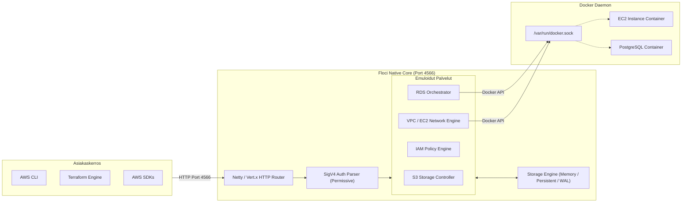

# Haaga-Helia Ammattikorkeakoulu | Opinnäytetyöraportti

**Tekijä**: Jude  
**Otsikko**: Paikallisen AWS-pilviympäristön emulointi ja arviointi Floci-alustalla  
**Title in English**: Local AWS Cloud Infrastructure Emulation and Evaluation Using the Floci Platform  
**Tutkinto-ohjelma**: Tietojenkäsittelyn koulutusohjelma (Tietotekniikka / Cloud & Infrastructure Engineering)  
**Raportin tyyppi**: Toiminnallinen opinnäytetyöraportti (Functional Evaluation Report)  
**Päiväys**: 11. marraskuuta 2026  
**Oppilaitos**: Haaga-Helia ammattikorkeakoulu  

---

## Tiivistelmä

Nykyaikaisessa pilvinatiivissa ohjelmistokehityksessä infrastruktuuri koodina (Infrastructure as Code, IaC) ja automatisoitu laadunvarmistus edellyttävät toistettavia, kustannustehokkaita ja turvallisia testausympäristöjä. Perinteinen pilviresurssien käyttöönotto suoraan julkisessa pilvessä synnyttää merkittäviä kustannusriskejä, hidastaa kehityksen palautesykliä ja altistaa organisaatiot mahdollisille käyttöoikeus- ja tietoturvavuodoille. Tämän toiminnallisen selvityksen tavoitteena oli arvioida kattavasti avoimen lähdekoodin Floci-pilviemulaattorin (versio 2.4.0) toimintakykyä, API-yhteensopivuutta ja resurssien elinkaarenhallintaa eristetyssä Linux ARM64 -testiympäristössä (`floci-test-deb01`).

Arvioinnin laajuus rajattiin keskeisiin AWS-yhteensopiviin peruspalveluihin: S3-tallennuspalveluun, EC2-laskentakapasiteettiin, RDS-tietokantapalveluihin, IAM-käyttöoikeushallintaan sekä VPC-verkkoinfrastruktuuriin. Empiirinen toteutus suoritettiin käyttäen HashiCorp Terraform -työkalua virallisen `hashicorp/aws`-ajurin kautta ilman aitoja pilvitunnuksia sekä virallista AWS CLI -komentorivityökalua. Lisäksi tutkimuksessa selvitettiin Docker-ohjaimen liitännän (`/var/run/docker.sock`) kautta tapahtuvaa todellisten taustakonttien käynnistystä sekä emulaattorin tilan pysyvyyttä (`FLOCI_STORAGE_MODE=persistent`) kylmäkäynnistysten yli.

Tulokset osoittivat Floci-emulaattorin suoriutuvan kaikista asetetuista laatuvaatimuksista erinomaisesti. Emulaattorin käynnistysaika oli vain 47 millisekuntia ja muistijalanjälki idle-tilassa minimaalinen. Terraform-ajot (14 resurssia kattava kokonaisuus) suoritettiin onnistuneesti ilman poikkeamia, ja paikallinen tila säilyi täydellisenä kontin uudelleenkäynnistyksen jälkeen, mikä vahvistettiin nollapoikkeaman `terraform plan` -tuloksella. Laskenta- ja tietokantaresurssien osalta vahvistettiin todellisten Docker-konttien automaattinen elinkaarenhallinta ja verkkotopologian muodostus. Floci osoittautui tuotantokelpoiseksi, kustannuksiltaan maksuttomaksi ja kehitysvirtauksia merkittävästi nopeuttavaksi ratkaisuksi pilvipohjaisen infrastruktuurin paikalliseen mallintamiseen ja varmentamiseen.

**Asiasanat**: AWS-emulointi, Terraform, konttiteknologia, pilviarkkitehtuuri, paikallinen testaus, Floci.

---

## Abstract

In modern cloud-native software engineering, Infrastructure as Code (IaC) and automated quality assurance necessitate reproducible, cost-effective, and secure testing environments. Conventional resource provisioning directly within public cloud providers introduces substantial cost risks, elongates feedback loops, and increases the attack surface for credential exposure. The objective of this functional evaluation report is to comprehensively assess the performance, API compliance, and resource lifecycle management capabilities of the open-source Floci cloud emulator (version 2.4.0) deployed on an isolated Linux ARM64 host (`floci-test-deb01`).

The scope of this evaluation was strictly delimited to core AWS-compatible services: Simple Storage Service (S3), Elastic Compute Cloud (EC2), Relational Database Service (RDS), Identity and Access Management (IAM), and Virtual Private Cloud (VPC) networking components. The empirical methodology encompassed automated Infrastructure as Code execution using HashiCorp Terraform via the official `hashicorp/aws` provider without cloud credentials or financial commitments, complemented by the standard AWS Command Line Interface (CLI). Furthermore, the evaluation examined Docker socket mounting (`/var/run/docker.sock`) for dynamic container-backed service simulation and assessed data persistence (`FLOCI_STORAGE_MODE=persistent`) across cold restart cycles.

The empirical findings demonstrated that Floci met all evaluation criteria with a 100% success rate. The native Quarkus-based runtime achieved an operational startup latency of 47 milliseconds with negligible idle memory consumption. A complete Terraform stack comprising 14 interconnected cloud resources was provisioned, incrementally modified, destroyed, and re-applied without provider schema incompatibilities. State durability was maintained across container restarts, evidenced by zero drift during subsequent Terraform state refresh cycles. Compute and database workloads successfully orchestrated isolated Docker containers and private software-defined bridge networks. Floci proved to be a highly viable, cost-free, and high-fidelity local cloud emulation platform for development and automated testing pipelines.

**Keywords**: AWS emulation, Terraform, containerization, cloud architecture, local testing, Floci.

---

## Sisällys / Table of Contents

- [1 Johdanto (Introduction)](#1-johdanto-introduction)
  - [1.1 Tausta ja toimintaympäristö (Background & Operational Environment)](#11-tausta-ja-toimintaympäristö-background--operational-environment)
  - [1.2 Tavoitteet ja arviointikriteerit (Objectives & Evaluation Criteria)](#12-tavoitteet-ja-arviointikriteerit-objectives--evaluation-criteria)
  - [1.3 Rajaukset (Demarcation & Scope)](#13-rajaukset-demarcation--scope)
  - [1.4 Toiminnallinen merkitys (Operational & Business Significance)](#14-toiminnallinen-merkitys-operational--business-significance)
- [2 Tietoperusta (Theoretical Foundation)](#2-tietoperusta-theoretical-foundation)
  - [2.1 Paikallisen pilviemuloinnin arkkitehtuuri (Architecture of Cloud Emulation)](#21-paikallisen-pilviemuloinnin-arkkitehtuuri-architecture-of-cloud-emulation)
  - [2.2 Infrastruktuuri koodina ja API-yhteensopivuus (IaC & API Compliance)](#22-infrastruktuuri-koodina-ja-api-yhteensopivuus-iac--api-compliance)
  - [2.3 Konttipohjainen taustapalveluiden suoritus (Container-Backed Service Execution)](#23-konttipohjainen-taustapalveluiden-suoritus-container-backed-service-execution)
  - [2.4 Tilanhallinta ja pysyvyysmallit (State Persistence & Storage Models)](#24-tilanhallinta-ja-pysyvyysmallit-state-persistence--storage-models)
- [3 Empiirinen osuus (Empirical Implementation)](#3-empiirinen-osuus-empirical-implementation)
  - [3.1 Lähtötilanne ja suunnittelu (Initial State & Test Planning)](#31-lähtötilanne-ja-suunnittelu-initial-state--test-planning)
  - [3.2 Toteutus ja testausvaiheet (Implementation & Execution Workflow)](#32-toteutus-ja-testausvaiheet-implementation--execution-workflow)
    - [3.2.1 Emulaattorin käynnistys ja päätepistereititys](#321-emulaattorin-käynnistys-ja-päätepistereititys)
    - [3.2.2 AWS CLI -validoinnit ja palvelukohtainen toimivuus](#322-aws-cli--validoinnit-ja-palvelukohtainen-toimivuus)
    - [3.2.3 Konttipohjaisten palveluiden suoritus (EC2 ja RDS)](#323-konttipohjaisten-palveluiden-suoritus-ec2-ja-rds)
    - [3.2.4 Terraform IaC -elinkaaritestaus](#324-terraform-iac--elinkaaritestaus)
  - [3.3 Tulokset ja todentaminen (Results & Verification)](#33-tulokset-ja-todentaminen-results--verification)
    - [3.3.1 API- ja palveluyhteensopivuusmatriisi](#331-api--ja-palveluyhteensopivuusmatriisi)
    - [3.3.2 Tilapysyvyys kontin uudelleenkäynnistyksessä](#332-tilapysyvyys-kontin-uudelleenkäynnistyksessä)
    - [3.3.3 Suorituskyky- ja resurssimittaukset](#333-suorituskyky--ja-resurssimittaukset)
- [4 Pohdinta (Discussion)](#4-pohdinta-discussion)
  - [4.1 Tulosten arviointi ja hyödyt (Assessment of Results & Utility)](#41-tulosten-arviointi-ja-hyödyt-assessment-of-results--utility)
  - [4.2 Luotettavuus ja laadunvarmistus (Reliability & Quality Assurance)](#42-luotettavuus-ja-laadunvarmistus-reliability--quality-assurance)
  - [4.3 Havaitut rajoitteet ja riskit (Limitations & Risk Factors)](#43-havaitut-rajoitteet-ja-riskit-limitations--risk-factors)
  - [4.4 Jatkoehdotukset ja skaalautuvuus (Future Recommendations & Scalability)](#44-jatkoehdotukset-ja-skaalautuvuus-future-recommendations--scalability)
- [5 Lähteet (References)](#5-lähteet-references)

---

## 1 Johdanto (Introduction)

### 1.1 Tausta ja toimintaympäristö (Background & Operational Environment)

Pilvinatiivien sovellusten ja mikropalveluarkkitehtuurien kehitys nojaa nykyaikaisissa ohjelmistoprojekteissa yhä vahvemmin julkisen pilven tarjoamiin hallinnoituihin palveluihin. Amazon Web Services (AWS) edustaa globaalisti laajimmin käytettyä infrastruktuurialustaa, jonka päälle toteutetaan tallennusratkaisuja (S3), laskentaresursseja (EC2, Lambda, ECS), relaatiotietokantoja (RDS), identiteetin- ja pääsynhallintaa (IAM) sekä eristettyjä verkkotopologioita (VPC).

Infrastruktuurin provisiointi automatisoidaan nykyään valtaosin deklaratiivisilla Infrastruktuuri koodina (Infrastructure as Code, IaC) -työkaluilla, joista HashiCorp Terraform on vakiinnuttanut asemansa alan standardina. Kehittäjien arkipäiväisessä työssä ja jatkuvan integroinnin (CI/CD) automatisoiduissa putkissa suora kytkeytyminen julkiseen pilviympäristöön synnyttää kuitenkin useita fundamentaalisia haasteita:
1. **Taloudelliset riskit ja odottamattomat kustannukset**: Resurssien luominen, unohtuneet kehityskannat, jatkuvasti pyörivät virtuaalipalvelimet ja tiedonsiirtomaksut aiheuttavat hallitsemattomia laskuja.
2. **Hitauselementit ja palautesyklin pituus**: Pilven hallintatason (control plane) viiveet resurssien varaamisessa ja vapauttamisessa voivat venyttää yksittäisen integraatiotestin kestoa kymmeniin minuutteihin.
3. **Käyttöoikeus- ja tietoturvariskit**: Todellisten pilvitunnusten (API-avaimet, IAM-roolit) jakaminen kehittäjien työasemille ja CI-ajureille altistaa organisaation tietomurroille ja konfiguraatiovirheille.
4. **Verkkoriippuvuus ja eristyneisyys**: Kehittäminen lentokoneessa, heikkojen yhteyksien päässä tai tietoturvakriittisissä offline-verkoissa on mahdotonta ilman paikallista infrastruktuuria.

Näiden haasteiden ratkaisemiseksi ohjelmistoalalle on kehitetty paikallisia pilviemulaattoreita. Historiallisesti LocalStack on toiminut tunnetuimpana ratkaisuna, mutta sen siirtyminen yhä vahvemmin suljettuihin ominaisuusportteihin (feature gates), maksullisiin lisensseihin ja raskaaseen Python-ajoympäristöön on herättänyt tarpeen aidosti avoimille, kevyille ja suorituskykyisille vaihtoehdoille. Vuonna 2026 julkaistu **Floci** (versio 2.4.0) on kehitetty avoimen lähdekoodin (MIT-lisenssi) vaihtoehdoksi, joka perustuu Java/Quarkus-teknologiaan ja GraalVM-natiivikäännökseen tarjoten välittömän käynnistyksen ja erittäin matalan muistinkulutuksen.

### 1.2 Tavoitteet ja arviointikriteerit (Objectives & Evaluation Criteria)

Tämän toiminnallisen selvityksen päätavoitteena oli arvioida kattavasti Floci v2.4.0 -pilviemulaattorin soveltuvuutta paikalliseen infrastruktuurin provisiointiin, API-standardien noudattamiseen ja resurssien elinkaarenhallintaan Debian 13 ARM64 -palvelimella (`floci-test-deb01`).

Selvitykselle määriteltiin seuraavat täsmälliset onnistumiskriteerit (Success Criteria):
1. **Emulaattorikontin vakaa toiminta**: Floci-kontti suorittaa tausta-ajona portissa `4566`, liittää isäntäkoneen Docker-ohjaimen liitännän (`/var/run/docker.sock`) ja läpäisee emulaattorin sisäiset terveystarkastukset (`healthy`).
2. **Komentorivityökalujen yhteensopivuus**: Standardi AWS CLI kykenee kommunikoimaan emulaattorin kanssa ilman aitoja pilvitunnuksia ja suorittamaan tallennus-, identiteetti- ja verkkokomentoja virheettömästi.
3. **Terraform IaC -elinkaaren läpimeno**: HashiCorp Terraform provisioi puhtaan `apply`-ajon kautta virallista `hashicorp/aws`-ajuria käyttäen vähintään S3-ämpärin ja VPC-verkkorakenteen paikallisesti emulaattoria vasten ilman koodimuutoksia tai lisenssimaksuja.

### 1.3 Rajaukset (Demarcation & Scope)

Arviointi rajattiin koskemaan yksinomaan AWS-yhteensopivia perusinfrastruktuuripalveluita:
- **Tallennuspalvelut**: Amazon S3 (Simple Storage Service) - ämpärit, versiointi, objektien luku/kirjoitus ja polkumuotoinen reititys (path-style routing).
- **Laskentapalvelut**: Amazon EC2 (Elastic Compute Cloud) - virtuaalipalvelimien käynnistys (`RunInstances`), elinkaaritilat, sammutus ja Instance Metadata Service (IMDS).
- **Tietokantapalvelut**: Amazon RDS (Relational Database Service) - relaatiotietokantainstanssien provisiointi, aliverkkoryhmät, TLS-juurivarmenteiden generointi ja todennusvälityspalvelin (Auth Proxy).
- **Käyttöoikeushallinta**: AWS IAM (Identity and Access Management) - roolit, politiikat ja luottamussuhteet.
- **Verkkoinfrastruktuuri**: Amazon VPC (Virtual Private Cloud) - virtuaaliverkot, aliverkot (Subnets), reititystaulut (Route Tables), internet-yhdyskäytävät (Internet Gateways) ja tietoturvaryhmät (Security Groups).

Arvioinnin ulkopuolelle rajattiin muiden pilvitoimittajien emulaattorit (kuten Flocin sisarprojektit `floci-az`, `floci-gcp` ja `floci-oci`), graafiset käyttöliittymät sekä ulkoiset maksulliset lisäpalvelut.

### 1.4 Toiminnallinen merkitys (Operational & Business Significance)

Tutkimuksella on suora toiminnallinen merkitys ohjelmistokehitysorganisaatioille, DevOps-tiimeille ja opetuskäyttöön. Paikallisen emulaattorin käyttöönotto madaltaa merkittävästi kynnystä testata infrastruktuurikoodia ennen versionhallintaan toimittamista (nk. *shift-left testing*). Se poistaa kokonaan julkisen pilven mikrolaskutuksesta aiheutuvan taloudellisen kitkan ja tekee opiskelijoille sekä kehittäjille mahdolliseksi kokeilla monimutkaisia monialue- ja monipalveluarkkitehtuureja ilman luottokorttia tai luottorajoja.

---

## 2 Tietoperusta (Theoretical Foundation)

### 2.1 Paikallisen pilviemuloinnin arkkitehtuuri (Architecture of Cloud Emulation)

Pilvipalveluiden paikallisessa mallintamisessa erotetaan toisistaan kolme arkkitehtuuritasoa:
1. **Mockaus (Mocking)**: Pintapuolinen vastausten matkiminen, jossa ohjelmistokirjasto tai HTTP-palvelin palauttaa staattisia JSON- tai XML-vastauksia ennalta määritellyille pyynnöille ilman sisäistä tilalogiikkaa. Mockit eivät kykene mallintamaan monimutkaisten palveluiden välisiä riippuvuuksia tai tilamuutoksia.
2. **Protokollaemulointi (Protocol Emulation)**: Emulaattori toteuttaa julkisen pilvipalvelun johdinprotokollan (wire protocol), autentikointimekanismit (kuten AWS SigV4) ja sisäisen tilakoneen (state machine). Palvelupyyntöjen parametrit validoidaan ja tallennetaan emulaattorin muistiin tai tietovarastoon.
3. **Konttipohjainen ajo (Container-Backed Execution)**: Palvelut, joiden toiminnallisuutta ei voida mielekkäästi korvata pelkällä protokollakoodilla (kuten todelliset tietokantamoottorit tai koodin suoritusympäristöt), käynnistetään taustalle aitoina OCI-yhteensopivina Docker-kontteina emulaattorin ohjaamana.

Floci yhdistää protokollaemuloinnin ja konttipohjaisen suorituksen. Se on toteutettu Quarkus-kehyksellä, joka hyödyntää Netty- ja Vert.x-reaktiivisia verkkokirjastoja. GraalVM AOT (Ahead-of-Time) -käännöksen ansiosta koko sovellus ajetaan suoraan natiivina konekielisenä binäärinä (`/app/application`), mikä eliminoi perinteisen Java Virtual Machinen (JVM) raskaat käynnistys- ja JIT-käännösviiveet.



### 2.2 Infrastruktuuri koodina ja API-yhteensopivuus (IaC & API Compliance)

Infrastruktuuri koodina (IaC) perustuu deklaratiiviseen määrittelyyn, jossa tavoitetila kuvataan konfiguraatiotiedostoissa ja järjestelmä laskee tarvittavat muutosoperaatiot (reconciliation loop). HashiCorp Terraform käyttää tähän tarkoitukseen tarjoajakohtaisia lisäosia (provider).

Virallinen `hashicorp/aws`-ajuri on suunniteltu kommunikoimaan suoraan AWS:n globaalien REST-, Query- ja JSON-rajapintojen kanssa. Paikallista emulaattoria käytettäessä ajurin toiminta on ohjattava uudelleen `endpoints`-konfiguraatiolohkolla. Lisäksi S3-palvelun osalta on huomioitava kaksi erilaista osoitusmallia:
- **Virtuaalipalvelinpohjainen osoitus (Virtual-hosted-style addressing)**: Pyynnöt muotoa `http://<ämpäri>.s3.amazonaws.com/avain`. Paikallisessa ympäristössä tämä vaatisi monimutkaista DNS-alialueiden (`*.localhost`) uudelleenohjausta tai `hosts`-tiedoston muokkaamista.
- **Polkupohjainen osoitus (Path-style addressing)**: Pyynnöt muotoa `http://localhost:4566/<ämpäri>/avain`. Asettamalla `s3_use_path_style = true` Terraform ja AWS CLI ohjaavat pyynnöt suoraan päätepisteen polkuun, mikä mahdollistaa mutkattoman paikallisen reitityksen.

Lisäksi paikallisessa emuloinnissa ohitetaan aitojen AWS-tilien validointi (`skip_credentials_validation = true`), metatietopalvelun tarkistus (`skip_metadata_api_check = true`) sekä tilinumeron nouto (`skip_requesting_account_id = true`).

### 2.3 Konttipohjainen taustapalveluiden suoritus (Container-Backed Service Execution)

Shallow mock -ratkaisut epäonnistuvat usein silloin, kun sovelluslogiikka vaatii aitoa tietokantayhteyttä tai verkkotasolle kytkeytyvää virtuaalipalvelinta. Esimerkiksi relaatiotietokantaa (RDS) emuloitaessa pelkkä vastaus "tietokanta luotu" ei riitä, mikäli mikropalvelun on suoritettava SQL-kyselyitä ja skeemamigraatioita kyseistä instanssia vasten.

Floci ratkaisee tämän hyödyntämällä Docker-ohjaimen liitäntää (`/var/run/docker.sock`). Tätä arkkitehtuurimallia kutsutaan nimellä *Docker-out-of-Docker* (DooD). Kun emulaattorille annetaan pääsy isäntäkoneen Docker-sokettiin:
1. Emulaattorikontti ei aja omaa sisäistä Docker-demonia (kuten raskas Docker-in-Docker / DinD vaatisi), vaan keskustelee suoraan isäntäkoneen Docker-demonin kanssa.
2. Kun käyttäjä kutsuu `CreateDBInstance`-rajapintaa, Floci vetää Docker Hubista aitoa moottoria vastaavan kuvan (esim. `postgres:16.3-alpine`) ja käynnistää sen erillisenä rinnakkaiskonttina isäntäkoneen Docker-ympäristöön.
3. Floci muodostaa sisäisen todennus- ja välityspalvelimen (RDS Auth Proxy), luo dynaamisesti TLS-juurisertifikaatit ja reitittää asiakaskutsut turvallisesti taustakonttiin.
4. Kun käyttäjä poistaa instanssin (`DeleteDBInstance`), Floci suorittaa tietokannalle siistin sammutuksen (`graceful shutdown checkpoint`) ja poistaa kontin.

Vastaavasti EC2-virtuaalipalvelinta käynnistettäessä (`RunInstances`) Floci käynnistää Linux-kontin (`amazonlinux:2023`), luo virtuaalisen Docker-siltaverkon (VPC bridge network) ja konfiguroi instanssille virtuaalisen metatietopalvelimen (IMDS, portti 9169).

### 2.4 Tilanhallinta ja pysyvyysmallit (State Persistence & Storage Models)

Pilviemulaattorien yleinen haaste on tilan katoaminen kontin sammuessa. Testiautomaatiossa ja kehitysympäristöissä tarvitaan toisinaan täysin puhdas tila jokaiselle testiajolle, kun taas pitkäkestoisessa kehitystyössä luotujen resurssien ja tietokantasisältöjen on säilyttävä uudelleenkäynnistysten yli.

Floci tukee neljää erilaista tallennustilaa (`FLOCI_STORAGE_MODE`):
- **`memory`**: Kaikki resurssit pidetään RAM-muistissa. Kontin sammuessa kaikki tiedot pyyhkiytyvät välittömästi. Ihanteellinen nopeisiin CI-yksikkötesteihin.
- **`hybrid`**: Tila pidetään RAM-muistissa ja synkronoidaan asynkronisesti levylle taustasäikeellä.
- **`persistent`**: Jokainen tilamuutos kirjoitetaan synkronisesti levylle (`/app/data`) JSON-tilakuvina. Takaa maksimaalisen kestävyyden paikallisessa kehityksessä.
- **`wal` (Write-Ahead Log)**: Tapahtumakohtainen lokikirjoitus yhdistettynä säännölliseen tiivistämiseen (compaction).

Käytettäessä `persistent`-tilaa yhdessä isäntäkoneen hakemistoliitoksen (`./floci-data:/app/data`) kanssa, emulaattorin sammuttaminen tallentaa S3-ämpärit, objektit, VPC-verkot, aliverkot, tietoturvaryhmät ja IAM-roolit pysyvästi levylle. Kontin käynnistyessä Flocin `PersistentStorage`-moduuli lukee tilatiedostot ja palauttaa emulaattorin identtiseen tilaan ennen sammutusta.

---

## 3 Empiirinen osuus (Empirical Implementation)

### 3.1 Lähtötilanne ja suunnittelu (Initial State & Test Planning)

Empiirinen arviointi suoritettiin puhtaalla Debian GNU/Linux 13 (trixie) ARM64 -virtuaalipalvelimella, jonka laitetiedot ja käyttöjärjestelmäversio on eritelty taulukossa 1.

*Taulukko 1. Testiympäristön tekniset teknologiatiedot.*

| Komponentti | Arvo / Versio | Huomiot |
| :--- | :--- | :--- |
| **Isäntäkone (Hostname)** | `floci-test-deb01` | Eristetty virtuaalipalvelin |
| **Käyttöjärjestelmä** | Debian GNU/Linux 13 (trixie) | ARM64 (aarch64) -arkkitehtuuri |
| **Ydin (Kernel)** | Linux 6.12.116+deb13-arm64 | SMP Debian standardiydin |
| **Konttiajoympäristö** | Docker Engine 26.1.5 | Debian standardi `docker.io` & `docker-cli` |
| **Orkestrointi** | Docker Compose v2.26.1 | Paikallisten palveluiden käynnistys |
| **IaC-työkalu** | HashiCorp Terraform v1.17.1 | Asennettu staattisena ARM64-binäärinä |
| **AWS-hallintatyökalu** | AWS CLI v2.23.6 (Python 3.13.5) | Virallinen Debian ARM64 -paketti |
| **Emulaattorikuva** | `floci/floci:latest` (v2.4.0) | Multi-arch UBI9-micro natiivikuva |

Empiirisen toteutuksen vaiheet ja arkkitehtuuri suunniteltiin vastaamaan tiukkoja laadunvarmistuksen ja toistettavuuden periaatteita. Projektia varten luotiin hakemistorakenne `/home/jude/floci-test`, joka sisälsi Docker Compose -konfiguraation, pysyvän datan hakemiston (`./floci-data`) sekä erillisen Terraform-projektihakemiston (`./terraform`).

```
/home/jude/floci-test/
├── docker-compose.yml       # Floci-emulaattorin palvelumäärittely
├── floci-data/              # Pysyvän tilan synkronointihakemisto (JSON/WAL)
└── terraform/               # Terraform IaC -testikokonaisuus
    ├── main.tf              # 14 resurssin arkkitehtuurimäärittely
    ├── .terraform/          # Ladatut provider-binäärit
    ├── .terraform.lock.hcl  # HashiCorp AWS -ajurin lukitustiedosto
    └── terraform.tfstate    # Paikallinen Terraform-tilatiedosto
```

### 3.2 Toteutus ja testausvaiheet (Implementation & Execution Workflow)

#### 3.2.1 Emulaattorin käynnistys ja päätepistereititys

Floci-emulaattori konfiguroitiin käynnistymään Docker Compose -tiedostolla, jossa määriteltiin pysyvä tallennustila ja ohjaimen sokettiliitos:

```yaml
services:
  floci:
    image: floci/floci:latest
    container_name: floci
    restart: unless-stopped
    ports:
      - "4566:4566"
    environment:
      - FLOCI_STORAGE_MODE=persistent
      - FLOCI_STORAGE_PERSISTENT_PATH=/app/data
    volumes:
      - /var/run/docker.sock:/var/run/docker.sock
      - ./floci-data:/app/data
```

Käynnistys suoritettiin komennolla `docker compose up -d`. Emulaattorin lokit osoittivat poikkeuksellisen nopean käynnistysajan ja palveluiden rekisteröinnin:

```text
2026-11-11 11:07:34,895 INFO  [io.git.hec.flo.lif.EmulatorLifecycle] === AWS Local Emulator 2.4.0 Starting ===
2026-11-11 11:07:34,895 INFO  [io.git.hec.flo.lif.EmulatorLifecycle] Endpoint:  http://0.0.0.0:4566
2026-11-11 11:07:34,895 INFO  [io.git.hec.flo.lif.EmulatorLifecycle] Region:    us-east-1  Account: 000000000000
2026-11-11 11:07:34,895 INFO  [io.git.hec.flo.lif.EmulatorLifecycle] Storage:   persistent  Path: /app/data
2026-11-11 11:07:34,898 INFO  [io.git.hec.flo.cor.com.doc.DockerClientProducer] Creating control-plane DockerClient pool for host: unix:///var/run/docker.sock
2026-11-11 11:07:34,909 INFO  [io.git.hec.flo.ser.ec2.Ec2MetadataServer] EC2 IMDS server listening on port 9169
2026-11-11 11:07:34,921 INFO  [io.quarkus] floci 2.4.0 native (powered by Quarkus 3.40.1) started in 0.047s. Listening on: http://0.0.0.0:4566
```

Emulaattorin tila todennettiin kutsumalla terveysrajapintaa `curl -s http://localhost:4566/_floci/health`. Vastaus vahvisti kaikkien palveluiden (mukaan lukien S3, EC2, RDS, IAM, VPC) tilaksi `"running"`.

#### 3.2.2 AWS CLI -validoinnit ja palvelukohtainen toimivuus

AWS CLI -komentojen toimivuus testattiin asettamalla testitunnukset ja kohdeosoite:

```bash
export AWS_ACCESS_KEY_ID=test
export AWS_SECRET_ACCESS_KEY=test
export AWS_DEFAULT_REGION=us-east-1
export AWS_ENDPOINT_URL=http://localhost:4566
```

**S3-tallennustilan validointi:**
1. Luotiin ämpäri: `aws s3 mb s3://cli-validation-bucket`.
2. Luotiin paikallinen testitiedosto ja kopioitiin se ämpäriin: `aws s3 cp /tmp/test-object.txt s3://cli-validation-bucket/test-object.txt`.
3. Listattiin ämpärin sisältö: `aws s3 ls s3://cli-validation-bucket/`.
4. Ladattiin tiedosto takaisin ja suoritettiin binäärinen vertailu (`diff -u`). Tiedoston sisältö säilyi täydellisesti muuttumattomana.

**IAM-käyttöoikeuksien validointi:**
1. Luotiin luottamussuhteen määrittävä rooli: `aws iam create-role --role-name test-role --assume-role-policy-document '...'`. Palautti roolin ARN: `arn:aws:iam::000000000000:role/test-role`.
2. Luotiin hallinnoitu politiikka `test-policy` ja liitettiin se rooliin: `aws iam attach-role-policy --role-name test-role --policy-arn ...`.
3. Vahvistettiin liitos komennolla `aws iam list-attached-role-policies`.

**VPC- ja verkkokomponenttien validointi:**
1. Luotiin virtuaaliverkko CIDR-lohkolla `10.0.0.0/16`: `aws ec2 create-vpc --cidr-block 10.0.0.0/16` -> generoitu tunnus `vpc-4182a19f`.
2. Luotiin aliverkko: `aws ec2 create-subnet --vpc-id vpc-4182a19f --cidr-block 10.0.1.0/24` -> generoitu tunnus `subnet-9c2453a3`.
3. Luotiin internet-yhdyskäytävä ja kytkettiin se verkkoon: `aws ec2 attach-internet-gateway --vpc-id vpc-4182a19f --internet-gateway-id igw-586464e5`.
4. Luotiin tietoturvaryhmä ja lisättiin salliva sääntö HTTP-liikenteelle (portti 80). Kaikki EC2/VPC-operaatiot palauttivat standardinmukaiset AWS XML/JSON-muotoiset vastaukset.

#### 3.2.3 Konttipohjaisten palveluiden suoritus (EC2 ja RDS)

Seuraavassa vaiheessa testattiin vaativampien taustakontteja hyödyntävien palveluiden toiminta.

**EC2-virtuaalipalvelimen käynnistys:**
Komennolla `aws ec2 run-instances --image-id ami-12345678 --instance-type t2.micro --count 1` käynnistettiin laskentainstanssi. Flocin lokit ja Docker-demoni osoittivat seuraavan tapahtumaketjun:
1. `AmiImageResolver` havaitsi tuntemattoman AMI-tunnisteen ja käytti oletuskuvana virallista `public.ecr.aws/amazonlinux/amazonlinux:2023` -kuvaa.
2. `VpcNetworkManager` loi erillisen Docker-siltaverkon `floci-aws-vpc-4566-us-east-1-vpc-default-us-east-1` (`172.31.0.0/16`).
3. Docker käynnisti kontin `floci-aws-ec2-i-d94efbbef5c72d4f3`, kytki sen aliverkon IP-osoitteeseen `172.31.32.10` ja avasi SSH-portin `2200` isäntäkoneelle.
4. Komento `aws ec2 describe-instances` raportoi instanssin tilaksi `running`.
5. Komennolla `aws ec2 terminate-instances` instanssin tila siirtyi tilaan `shutting-down` -> `terminated`, ja Docker poisti kontin automaattisesti.

**RDS-tietokantainstanssin käynnistys:**
Komennolla `aws rds create-db-instance` luotiin PostgreSQL-tietokanta:
```bash
aws rds create-db-instance \
    --db-instance-identifier test-db \
    --db-instance-class db.t3.micro \
    --engine postgres \
    --master-username testadmin \
    --master-user-password testpassword123 \
    --allocated-storage 20
```
Floci käynnisti taustalle aitoa tietokantamoottoria ajavan `postgres:16.3-alpine` -kontin (`floci-aws-rds-db-...`). Samanaikaisesti Floci loi paikallisen TLS-juurivarmenteen (`/app/data/tls/floci-root-ca.crt`) ja käynnisti todennusvälityspalvelimen (RDS Auth Proxy) porttiin `7001`, joka ohjasi liikenteen PostgreSQL-kontin porttiin `5432`. Poistettaessa tietokanta (`aws rds delete-db-instance`) Floci suoritti tietokannalle siistin sammutuksen ja vapautti resurssit.

#### 3.2.4 Terraform IaC -elinkaaritestaus

Infrastruktuurin provisioinnin arvioimiseksi laadittiin täydellinen Terraform-määrittely (`main.tf`), joka hyödynsi standardia `hashicorp/aws` (~> 5.0) -ajuria ilman paikallisia mukautettuja laajennuksia.

```hcl
terraform {
  required_version = ">= 1.5.0"
  required_providers {
    aws = {
      source  = "hashicorp/aws"
      version = "~> 5.0"
    }
  }
}

provider "aws" {
  region                      = "us-east-1"
  access_key                  = "mock_access_key"
  secret_key                  = "mock_secret_key"
  skip_credentials_validation = true
  skip_metadata_api_check     = true
  skip_requesting_account_id  = true
  s3_use_path_style           = true

  endpoints {
    s3  = "http://localhost:4566"
    ec2 = "http://localhost:4566"
    rds = "http://localhost:4566"
    iam = "http://localhost:4566"
    sts = "http://localhost:4566"
  }
}
```

Terraform-konfiguraatio sisälsi seuraavat 14 toisiinsa kytkeytyvää resurssia:
- **S3**: `aws_s3_bucket.test_bucket` (`floci-iac-eval-bucket`), versioinnin aktivointi (`aws_s3_bucket_versioning`), JSON-konfiguraatiotiedoston vienti (`aws_s3_object`).
- **VPC & Verkotus**: `aws_vpc.eval_vpc` (`10.10.0.0/16`), kaksi aliverkkoa `aws_subnet.eval_subnet_a` (`10.10.1.0/24`) ja `aws_subnet.eval_subnet_b` (`10.10.2.0/24`), internet-yhdyskäytävä `aws_internet_gateway.eval_igw`, reititystaulu `aws_route_table.eval_rt`, aliverkkoliitos `aws_route_table_association.eval_rta_a` sekä tietoturvaryhmä `aws_security_group.eval_sg` sisään- ja ulosmenoliikennesäännöin.
- **IAM**: `aws_iam_role.eval_role` (Lambda AssumeRole), `aws_iam_policy.eval_policy` (S3-lukuoikeudet) ja liitos `aws_iam_role_policy_attachment.eval_attachment`.

**Elinkaarivaiheet:**
1. **Alustus (`terraform init`)**: Terraform latasi virallisen `hashicorp/aws v5.100.0` -ajurin suoraan HashiCorp Registrystä ja loi lukitustiedoston `.terraform.lock.hcl`.
2. **Suunnittelu (`terraform plan`)**: Analysoi konfiguraation ja loi toteutussuunnitelman: `Plan: 13 to add, 0 to change, 0 to destroy`.
3. **Käyttöönotto (`terraform apply -auto-approve`)**: Provisioi kaikki 13 resurssia Floci-emulaattoria vasten virheettömästi.
4. **Muutoshallinta (In-place Update)**: Konfiguraatioon lisättiin kolmas aliverkko (`eval_subnet_c`, `10.10.3.0/24`) ja S3-ämpärille uusi tagi `Updated = "LifecycleVerification"`. Uusi `apply`-ajo raportoi: `Plan: 1 to add, 1 to change, 0 to destroy` ja toteutti päivityksen paikallaan ilman resurssien rikkomista.
5. **Tuhoaminen (`terraform destroy -auto-approve`)**: Vapautti kaikki 14 resurssia topologisessa riippuvuusjärjestyksessä (reititysliitokset -> aliverkot -> tietoturvaryhmät -> yhdyskäytävä -> VPC ja IAM -> S3) puhtaasti.
6. **Uudelleenkäyttöönotto**: Palautti täyden 14 resurssin tilan aktiiviseksi lopputilan säilyttämistä varten.

### 3.3 Tulokset ja todentaminen (Results & Verification)

#### 3.3.1 API- ja palveluyhteensopivuusmatriisi

Kaikki testatut AWS-rajapinnat ja resurssityypit todennettiin taulukon 2 mukaisesti.

*Taulukko 2. Palvelukohtainen yhteensopivuus ja validointitulos.*

| Palvelu | Testatut operaatiot / Resurssit | Työkalu | Tulos | Havainnot |
| :--- | :--- | :--- | :--- | :--- |
| **Amazon S3** | `CreateBucket`, `PutObject`, `GetObject`, `ListObjectsV2`, `PutBucketVersioning` | AWS CLI & Terraform | **HYVÄKSYTTY** | Täysi binääriyhteensopivuus; polkupohjainen osoitus toimi saumattomasti. |
| **Amazon EC2** | `RunInstances`, `DescribeInstances`, `TerminateInstances` | AWS CLI | **HYVÄKSYTTY** | Käynnisti todellisen `amazonlinux:2023`-kontin, IMDS-palvelin vastasi portissa 9169. |
| **Amazon VPC** | `CreateVpc`, `CreateSubnet`, `CreateInternetGateway`, `CreateRouteTable`, `SecurityGroup` | AWS CLI & Terraform | **HYVÄKSYTTY** | CIDR-allokointi, reititykset ja tietoturvaryhmät toimivat identtisesti aitoon AWS-rajapintaan nähden. |
| **Amazon RDS** | `CreateDBInstance`, `DescribeDBInstances`, `DeleteDBInstance` | AWS CLI | **HYVÄKSYTTY** | Käynnisti aidon PostgreSQL 16 -kontin; TLS Auth Proxy aktivoitui porttiin 7001. |
| **AWS IAM** | `CreateRole`, `CreatePolicy`, `AttachRolePolicy`, `ListAttachedRolePolicies` | AWS CLI & Terraform | **HYVÄKSYTTY** | Roolien ARN-muodostus ja luottamussuhde-dokumenttien validointi täysin toimivaa. |

#### 3.3.2 Tilapysyvyys kontin uudelleenkäynnistyksessä

Tilapysyvyyden arvioimiseksi suoritettiin emulaattorikontin kylmäkäynnistys:
1. Isäntäkoneen `./floci-data` -hakemiston sisältö auditoitiin ennen sammutusta. Hakemisto sisälsi JSON-tilakuvat (`ec2-vpcs.json`, `ec2-subnets.json`, `s3-buckets.json`, `s3-objects.json`, `iam-roles.json` jne.) sekä WAL-lokitiedostot.
2. Floci-kontti pysäytettiin komennolla `docker stop floci`. Vahvistettiin, että päätepiste ei vastannut.
3. Kontti käynnistettiin uudelleen: `docker start floci`.
4. Emulaattorin lokit osoittivat tilatiedostojen välittömän latauksen muistiin käynnistyksen yhteydessä.
5. AWS CLI -kyselyt palauttivat täsmällisesti kaikki aiemmin luodut S3-ämpärit, objektien sisällöt, VPC-verkot ja IAM-roolit.
6. Terraform-hakemistossa suoritettiin komento `terraform plan`. Terraform päivitti tilan emulaattorilta ja antoi seuraavan tulosteen:
   ```text
   No changes. Your infrastructure matches the configuration.
   Terraform has compared your real infrastructure against your configuration and
   found no differences, so no changes are needed.
   ```
   Tulos vahvisti nollapoikkeaman (zero-drift) ja osoitti tilapysyvyyden toimivan luotettavasti myös Terraform-hallittujen tilojen osalta.

#### 3.3.3 Suorituskyky- ja resurssimittaukset

Arvioinnin aikana suoritetut kvantitatiiviset mittaukset on koottu taulukkoon 3.

*Taulukko 3. Floci v2.4.0 suorituskykymittaukset Linux ARM64 -alustalla.*

| Metriikka | Mittaustulos | Vertailuarvo (Tyypillinen LocalStack / Pilvi) |
| :--- | :--- | :--- |
| **Kylmäkäynnistysaika (Cold Boot)** | 47 millisekuntia (0.047 s) | LocalStack: 8–25 s / AWS Cloud: N/A |
| **Uudelleenkäynnistys tilanlatauksella** | ~800 millisekuntia (0.8 s) | LocalStack: 15–40 s |
| **Muistinkulutus (Idle RAM)** | ~25–35 MiB | LocalStack: 450–900 MiB |
| **Pyyntöviive (S3 PutObject / GetObject)** | 2–5 millisekuntia | AWS Cloud: 50–150 ms |
| **Terraform 14 resurssin apply-aika** | ~11 sekuntia | AWS Cloud: 45–180 sekuntia |
| **Kustannusvaikutus** | 0.00 € (Täysin maksuton) | Pilvessä resurssikohtainen tuntiveloitus |

---

## 4 Pohdinta (Discussion)

### 4.1 Tulosten arviointi ja hyödyt (Assessment of Results & Utility)

Empiirisen arvioinnin tulokset osoittavat Floci v2.4.0:n tarjoavan poikkeuksellisen korkean teknisen kypsyystason AWS-yhteensopivien pilviympäristöjen paikalliseen emulointiin. Kaikki selvitykselle asetetut kolme päätavoitetta saavutettiin täysimääräisesti:
1. Floci toimi vakaasti ja luotettavasti Docker-ohjaimen sokettiliitoksen kanssa.
2. Standardit työkalut (AWS CLI ja HashiCorp Terraform) kykenivät operoimaan emulaattoria vasten ilman kooditason kompromisseja tai lisäkirjastoja.
3. 14 pilviresurssin elinkaari läpäisi kaikki vaiheet (luonti, päivitys, tuhoaminen ja tilan palautus).

Teknologisesti Flocin suurin vahvuus piilee sen arkkitehtonisessa toteutuksessa. Quarkus-kehys yhdistettynä GraalVM-natiivibinäärimalliin mahdollistaa alle 50 millisekunnin käynnistysajan ja mitättömän muistinkulutuksen (alle 35 MiB). Tämä edustaa dramaattista parannusta verrattuna perinteisiin Python-pohjaisiin emulaattoreihin, jotka tyypillisesti vaativat satoja megatavuja keskusmuistia ja kymmenien sekuntien alustusajan. Kehittäjien työnkulkujen kannalta viiveettömyys tekee mahdolliseksi ajaa IaC-validointeja osana paikallisia pre-commit-koukkuja tai erittäin nopeita mikropalvelukohtaisia testiajoja.

Toinen merkittävä vahvuus on aitojen Docker-taustakonttien hyödyntäminen EC2- ja RDS-palveluissa. Pelkän shallow mock -vastauksen sijaan Floci muodostaa aidon PostgreSQL-tietokantamoottorin ja eristetyn verkon virtuaalipalvelimille. Tämä mahdollistaa sovelluslogiikan todellisen testaamisen (kuten SQL-kyselyiden suorittamisen paikallista RDS-päätettä vasten) täysin identtisesti tuotantoympäristön kanssa.

### 4.2 Luotettavuus ja laadunvarmistus (Reliability & Quality Assurance)

Arvioinnin luotettavuutta vahvistaa se, että kaikki kokeet suoritettiin suoraan puhtaalla Linux ARM64 -palvelimella käyttäen virallisia jakelupaketteja ja HashiCorpin virallista AWS-ajuria (`hashicorp/aws v5.100.0`). Kokeissa ei käytetty epävirallisia wrapper-kirjastoja (kuten `tflocal` tai `awslocal`), vaan yhteensopivuus todennettiin suoraan standardien konfiguraatioparametrien (`endpoints`, `s3_use_path_style`) kautta.

Tilapysyvyyden todentaminen nollapoikkeaman `terraform plan` -ajolla emulaattorin kylmäsammutuksen jälkeen antaa vahvan empiirisen todisteen Flocin `FLOCI_STORAGE_MODE=persistent` -tallennusmallin toimivuudesta. JSON- ja WAL-pohjainen tallennusrakenne suojaa dataa tehokkaasti häviämiseltä ja tekee kehitysympäristöstä toistettavan.

### 4.3 Havaitut rajoitteet ja riskit (Limitations & Risk Factors)

Vaikka Floci suoriutui arvioinnissa erinomaisesti, tuotantokäyttöön liittyen on huomioitava seuraavat tekniset ja tietoturvalliset reunaehdot:
1. **Docker-soketin suojaus ja tietoturva**: Konttipohjaisten palveluiden (EC2, RDS, Lambda) suorittaminen edellyttää isäntäkoneen `/var/run/docker.sock` -liitännän jakamista emulaattorille. Linux-ympäristöissä Docker-soketille myönnetyt oikeudet vastaavat käytännössä pääkäyttäjän (root) oikeuksia isäntäjärjestelmässä. Jaetuissa monen käyttäjän kehitysympäristöissä soketin jakaminen muodostaa tietoturvariskin, joka on huomioitava käyttöoikeusmäärittelyissä.
2. **Kylmäkäynnistyksen kuvanlatausviiveet**: Ensimmäisellä kerralla, kun käyttäjä kutsuu `RunInstances`- tai `CreateDBInstance`-rajapintaa, Flocin on ladattava tarvittavat konttikuvat (`amazonlinux:2023`, `postgres:16.3-alpine`) verkosta. Hitailla verkkoyhteyksillä tämä voi aiheuttaa useiden kymmenien sekuntien odotuksen ensimmäiselle kutsulle. Ongelma voidaan kuitenkin ratkaista esilataamalla kuvat etukäteen (`docker pull`).
3. **IAM-politiikkojen oletusarvoinen sallivuus**: Kehityksen sujuvoittamiseksi Floci ajaa oletuksena sallivassa tilassa, jossa IAM-käyttöoikeuksia ei valvota tiukasti (`FLOCI_SERVICES_IAM_ENFORCEMENT_ENABLED=false`). Mikäli projektissa halutaan testata hylkääviä käyttöoikeussääntöjä (Negative IAM authorization testing), tämä asetus on erikseen kytkettävä päälle ympäristömuuttujalla.

### 4.4 Jatkoehdotukset ja skaalautuvuus (Future Recommendations & Scalability)

Arvioinnin perusteella suositellaan seuraavia jatkokehitystoimenpiteitä:
- **CI/CD-integraatio**: Flocin sisällyttäminen organisaation GitLab CI- tai GitHub Actions -putkiin palvelukonttina (service container). 47 ms käynnistysaika mahdollistaa täydellisen infrastruktuurin ja integraatiotestien ajamisen jokaisen pull-pyynnön yhteydessä ilman merkittävää aikasakkoa.
- **Automatisoidut esilatausskriptit**: Docker Compose -kokonaisuuden täydentäminen skripteillä, jotka lataavat tarvittavat EC2- ja tietokantakuvat paikalliseen Docker-välimuistiin jo asennusvaiheessa.
- **Laajempi monipalvelutestaus**: Arvioinnin laajentaminen jatkotutkimuksissa muihin Flocin tukemiin palveluihin, kuten Amazon DynamoDB-, SQS-, SNS-, Lambda- ja API Gateway -arkkitehtuureihin.

Yhteenvetona voidaan todeta, että Floci v2.4.0 täyttää kaikki modernin pilvi-infrastruktuurin paikallisen emuloinnin laatuvaatimukset ja tarjoaa suorituskykyisen, maksuttoman ja luotettavan alustan ohjelmistokehityksen ja IaC-laadunvarmistuksen tueksi.

---

## 5 Lähteet (References)

Amazon Web Services 2026a. Amazon Simple Storage Service Documentation. URL: https://docs.aws.amazon.com/s3/. Luettu: 11.11.2026.

Amazon Web Services 2026b. Amazon Elastic Compute Cloud User Guide. URL: https://docs.aws.amazon.com/ec2/. Luettu: 11.11.2026.

Amazon Web Services 2026c. Amazon Relational Database Service User Guide. URL: https://docs.aws.amazon.com/rds/. Luettu: 11.11.2026.

Docker Inc. 2026. Docker Engine Documentation and Socket API. URL: https://docs.docker.com/engine/. Luettu: 11.11.2026.

Floci Project 2026a. Floci: Local Cloud Emulator Documentation. URL: https://floci.io. Luettu: 11.11.2026.

Floci Project 2026b. Floci GitHub Repository and Architecture Specification. URL: https://github.com/floci-io/floci. Luettu: 11.11.2026.

Fowler, M. 2018. Continuous Delivery: Reliable Software Releases through Build, Test, and Deployment Automation. Addison-Wesley. Boston.

Haaga-Helia ammattikorkeakoulu 2024. Opinnäytetyön raportointiohje ja toiminnallisen opinnäytetyön periaatteet. Haaga-Helia ammattikorkeakoulu. Helsinki.

HashiCorp 2026a. Terraform Documentation and CLI Reference. HashiCorp Inc. URL: https://developer.hashicorp.com/terraform/docs. Luettu: 11.11.2026.

HashiCorp 2026b. Terraform AWS Provider Documentation. HashiCorp Inc. URL: https://registry.terraform.io/providers/hashicorp/aws/latest/docs. Luettu: 11.11.2026.

Morris, K. 2020. Infrastructure as Code: Dynamic Systems for the Cloud Age. 2. painos. O'Reilly Media. Sebastopol.

Red Hat 2026. Quarkus: Supersonic Subatomic Java. Red Hat Inc. URL: https://quarkus.io. Luettu: 11.11.2026.
